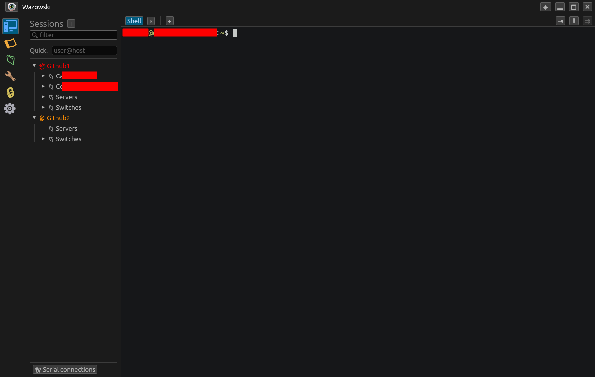

# Wazowski

A MobaXterm-style terminal, remote-session, and network toolbox, written
entirely in Rust. Primary target is Fedora Linux; it also builds for Windows and
macOS.

Wazowski puts your terminals, SSH/SFTP, **in-window RDP and VNC**, serial
consoles, saved sessions, credentials, macros, quick file/transfer servers, and
a set of network tools into one tabbed window.



## Highlights

- **Tabbed terminal** with a full emulator (colors, scrollback, selection,
  copy-on-select, right-click paste), split panes, and **broadcast** typing to
  many panes at once.
- **SSH sessions** with password / private-key / SSH-agent auth, host-key
  verification, a live handshake log, and a per-session **legacy mode** for old
  gear (ProCurve/HPE, etc.).
- **SFTP file browser** beside the active SSH tab; **SMB file browser** beside an
  RDP tab (`\\host\C$`).
- **Native, in-window RDP and VNC** (no external client) with a per-session
  quality setting and a remote-ops toolbar (screenshot, paste text,
  Ctrl+Alt+Del, Windows key). VNC supports VeNCrypt/TLS.
- **Serial console** support, with a quick device picker docked in the Sessions
  pane.
- **Session manager**: nested folders, drag-and-drop, per-item icons/colors,
  right-click actions, and quick-connect.
- **Encrypted vault** (Argon2id + XChaCha20-Poly1305) for passwords and keys,
  optionally auto-unlocked via the OS keyring; can generate Ed25519 key pairs.
- **Shared sessions** from a shared folder or a **git repo**, cached locally for
  offline use, with controlled push/sync (no secrets ever stored in a share).
- **Macros** to replay keystrokes/commands across one or many terminals.
- **Quick servers**: serve a folder over HTTP / TFTP / SFTP, or run an iperf3
  server.
- **Network & host tools**: a JSON/jq puller, a basic API client, an IP-address
  viewer, and per-session ping / port-scan / subnet-scan.
- **Settings backup/restore** to a single portable file.

## Documentation

Full docs live in [`docs/`](docs/README.md):

- [Getting started](docs/getting-started.md)
- [Terminal, tabs & panes](docs/terminal.md)
- [Connections: SSH, SFTP, RDP, VNC, Serial](docs/connections.md)
- [Session manager](docs/session-manager.md)
- [Vault (credentials)](docs/vault.md)
- [Shared sessions](docs/shared-sessions.md)
- [Macros](docs/macros.md)
- [Quick servers](docs/quick-servers.md)
- [Network & host tools](docs/tools.md)
- [Settings & backup](docs/settings-and-backup.md)
- [Keyboard shortcuts](docs/keybindings.md)
- [Importing from MobaXterm](docs/importing-from-mobaxterm.md)
- [Troubleshooting](docs/troubleshooting.md)

## Install

Download a build for your platform from the
[Releases](https://github.com/HoleInTheSeat/Wazowski/releases) page. Linux
releases include a **Fedora RPM** and a portable **AppImage** in addition to the
raw binary.

```sh
# Fedora (RPM): installs the app, desktop entry, and icons
sudo dnf install ./wazowski-*-linux-x86_64.rpm

# Any Linux (AppImage): no install needed
chmod +x Wazowski-*-x86_64.AppImage
./Wazowski-*-x86_64.AppImage
```

If you run the raw Linux binary, the GUI needs these runtime libraries:

- Fedora: `sudo dnf install libxkbcommon wayland-libs libX11 libXcursor libXrandr libXi mesa-libGL`
- Debian/Ubuntu: `sudo apt install libxkbcommon0 libwayland-client0 libx11-6 libxcursor1 libxrandr2 libxi6 libgl1`

Optional helpers Wazowski can use when present: `jq` (JSON filtering),
`smbclient` (RDP file browsing), `iperf3` (bandwidth server), and a printing
service (`lp`/`lpr`) for "Print output".

See [Troubleshooting](docs/troubleshooting.md) if the launcher/taskbar icon
doesn't appear after installing.

## Build from source

Requires the Rust toolchain ([rustup](https://rustup.rs)) and a C toolchain.

```sh
# Fedora build dependencies
sudo dnf install gcc gcc-c++ make libxkbcommon-devel wayland-devel \
  libX11-devel libXcursor-devel libXrandr-devel libXi-devel mesa-libGL-devel

git clone https://github.com/HoleInTheSeat/Wazowski.git
cd Wazowski
cargo run --release
```

## Project layout

```
crates/
  wazowski-app/      GUI: tabs, session manager, vault/sharing, tools, dialogs
  wazowski-term/     terminal widget (alacritty_terminal + egui) and serial
  wazowski-core/     encrypted vault, sessions, folders
  wazowski-ssh/      SSH/SFTP backends, host-key checks, key generation
  wazowski-remote/   native RDP (ironrdp) and VNC clients
  wazowski-servers/  quick servers (HTTP/TFTP/SFTP/iperf3)
tools/
  mxt2wazowski.py    MobaXterm .mxtsessions → Wazowski converter
```

## License

GPL-3.0-or-later. See [LICENSE](LICENSE).
