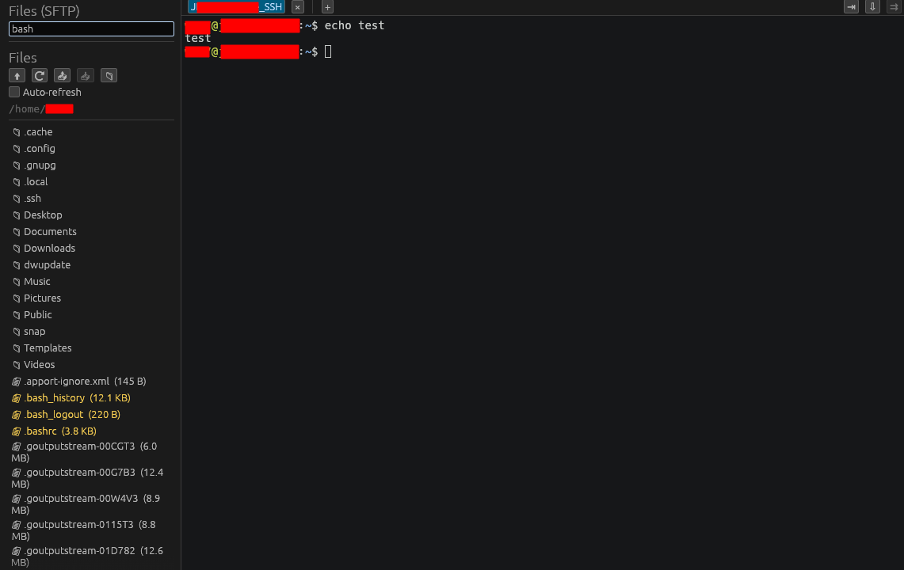
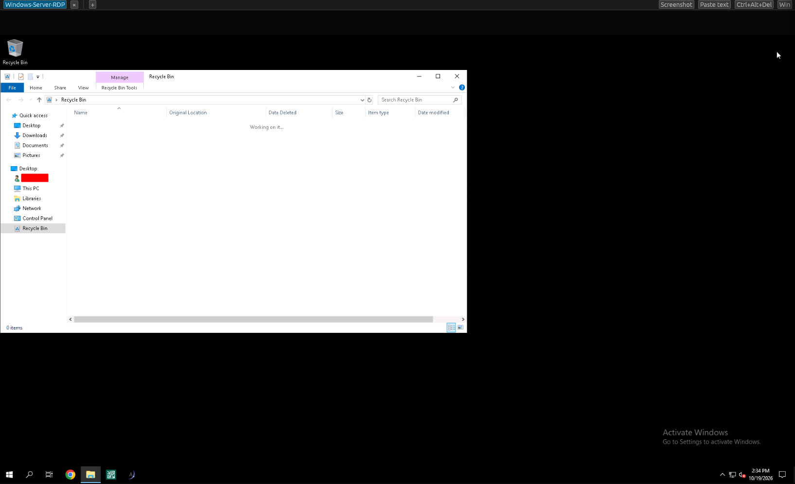
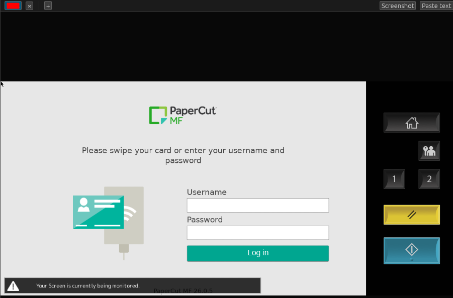
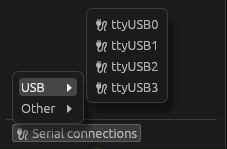

# Connections: SSH, SFTP, RDP, VNC, Serial

Wazowski connects with five protocols. SSH, RDP, and VNC are saved as
**sessions** (see [Session manager](session-manager.md)); serial has its own
quick picker.

## SSH

An SSH session opens as a terminal tab.

- **Auth**: SSH agent, a vault **password**, or a vault **SSH keypair**. A session
  with a blank password prompts you at connect time (MobaXterm-style).
- **Host-key verification** against `~/.ssh/known_hosts`: unknown or changed keys
  raise a prompt showing the fingerprint before you trust them.
- **Legacy mode** (per session) enables old algorithms — SHA-1 key exchange, CBC
  ciphers, DSA/`ssh-rsa` host keys — for gear like HPE/ProCurve switches.
- The connection shows a live, copyable **handshake log** with a retry button, so
  failures are easy to diagnose.

### Connect as…

Right-click a session → **Connect as…** to connect once with a different
username/password without changing the saved session.

### Open web GUI

Right-click a session → **Open web GUI** opens `http(s)://host` in your browser —
useful for devices with a web admin page. The scheme (http/https) is set in
**Settings → General**.

## SFTP file browser

With an SSH tab active, the **Files** view (📁) browses that host over the *same*
connection: navigate, **upload**, **download**, make folders, and delete.
Auto-refresh can be remembered per session. (Shown in the SSH screenshot above.)

## RDP (in-window)

RDP sessions render **inside a Wazowski tab** — no external client. (Built on
`ironrdp`.)

- **Quality** (per session): *Performance* (fastest, low color), *Balanced*
  (default), or *Quality* (full color, themes/font smoothing). Lower quality
  helps on slow links or when scrolling lots of text.
- **Resolution**: set a fixed width×height, or leave blank to fit the window.
- **Domain**: optional Windows domain.
- A session with no stored password prompts at connect time.

### SMB file browser

With an RDP tab active, the **Files** view browses the host's `\\host\C$` share
over SMB, using the session's credentials. (Uses `smbclient`, so Linux-only for
now.)

## VNC (in-window)

VNC sessions also render in a tab. (Built on `vnc-rs`.)

- **View only** — observe without sending input.
- **Quality** — Auto / High / Low encoding preference.
- **VeNCrypt / TLS** is supported (e.g. for copiers and appliances that require
  an encrypted VNC handshake).

## Remote-ops toolbar (RDP/VNC)

Active RDP and VNC tabs show a small toolbar of actions:

- **Screenshot** — save the current frame to a PNG (you choose where).
- **Paste text** — type your clipboard into the session as keystrokes.
  Multi-line clipboards ask for confirmation first, because the embedded newlines
  act as Enter presses.
- **Ctrl+Alt+Del** *(RDP)*.
- **Windows key** *(RDP)*.

## Serial consoles

Serial devices appear in the **Serial connections** dock pinned to the bottom of
the Sessions pane. Click it to open a menu grouped by kind (USB, Bluetooth,
PCI/onboard, Other); pick a device to open the connection dialog (port, baud,
data bits, parity, stop bits, flow control).

In a serial tab, raise/lower the baud rate with `Ctrl+Shift+↑` / `Ctrl+Shift+↓`.

