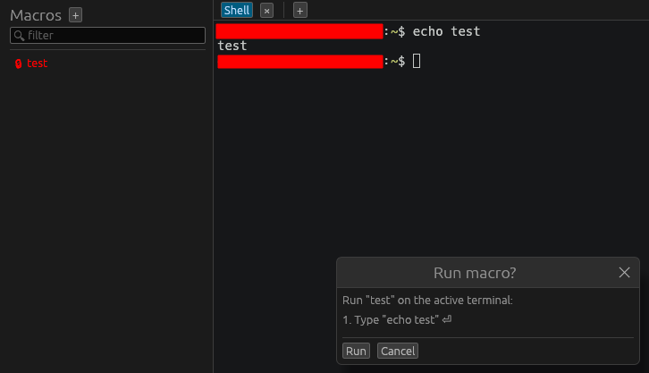

# Macros

A **macro** is a saved sequence of steps (keystrokes/commands) you can replay into
terminals — for example, a login dance, a set of show-commands, or a config
snippet you paste into many switches.

## Managing macros

Open the **Macros** view (📜):

- **New macro** (**+**): give it a name, add steps, and pick an icon/color.
- Each macro has a right-click menu with **Edit…**, **Duplicate**, and **Delete**
  (generic actions, alphabetical, as elsewhere).
- Filter the list with the search box.

## Running a macro

Double-click a macro to run it on the **active terminal**, or use its right-click
menu to choose a target:

- **Run on active terminal** — just the focused pane.
- **Run on this tab's panes** — every pane in the current tab.
- **Run on all terminals** — every open terminal.

Running from the menu always shows a **confirmation** first, listing the steps and
where they'll go, so a macro can't fire somewhere unexpected.

Jump to the Macros pane with `Ctrl+Shift+3` (rebindable in
[Settings → Keybindings](keybindings.md)).

## Macro shortcuts

A macro can have its own keyboard shortcut, set in the macro editor (**Keyboard
shortcut → click, then press the keys**; **Clear** to unbind). The shortcut runs
the macro on the **active terminal**, without a confirmation, and only fires while
a terminal tab has keyboard focus — so it never clashes with typing in the
sidebar, a filter box, or a dialog. Pick a combination that doesn't collide with a
built-in shortcut (those win).

## Tips

- Combine macros with **broadcast** / multi-pane targets to push the same change
  across many devices at once (see [Terminal](terminal.md)).
- Because running asks for confirmation and shows the target, it's safe to keep
  destructive macros around — you'll see exactly what will happen before it runs.
