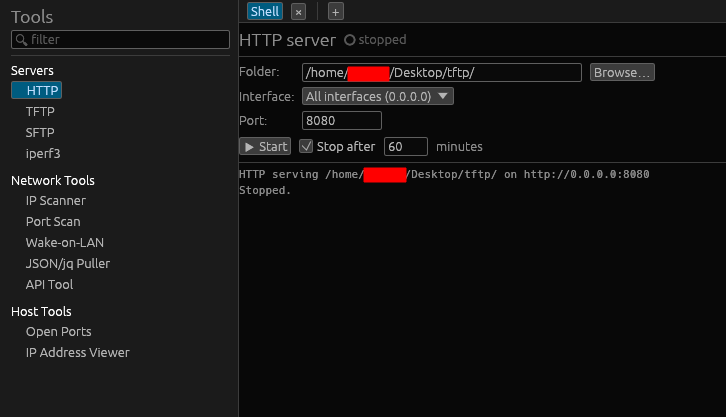

# Quick servers

Quick servers let you stand up a small file or transfer server in seconds — handy
for pushing firmware to a switch, grabbing a config off a device, or testing
bandwidth. Find them under **Tools** (🔧) → **Quick servers**.

## Server kinds

- **HTTP** — serve a folder read-only over HTTP.
- **TFTP** — serve a folder, read-only or **writable** (uploads), as network gear
  often expects for firmware/config.
- **SFTP** — serve a folder over SFTP with **password auth**, confined to that
  folder. Set a username (empty = anonymous / any username) and whether writes are
  allowed.
- **iperf3** — run an iperf3 bandwidth server (uses the system `iperf3` binary).

## Configuring

For each server you choose:

- the **folder** to serve (HTTP/TFTP/SFTP),
- the **bind address** (e.g. `0.0.0.0` for all interfaces, or `127.0.0.1`),
- the **port**,
- **writable** and **username** where applicable.

Configs **persist** between runs. Each server has a **live log** so you can watch
requests/transfers, and an optional **auto-stop** timer ("stop after N minutes").

## Running

Start/stop each server from its row. If binding a **low port** (< 1024) fails on
Linux, **Settings → Extras** can grant the binary the needed capability
(`setcap`), and the same page can install `iperf3` if it's missing.

## Security notes

- Serve only what you intend to; SFTP/TFTP writable mode accepts uploads into the
  served folder.
- Bind to `127.0.0.1` if you only need local access; use a specific interface
  rather than `0.0.0.0` on untrusted networks.
