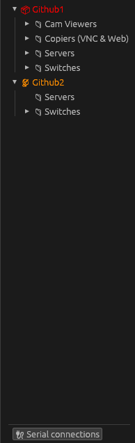
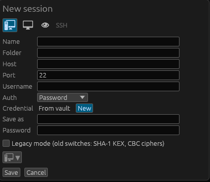
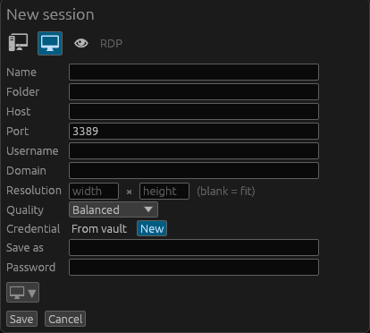
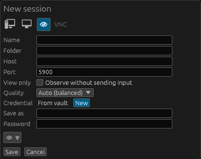
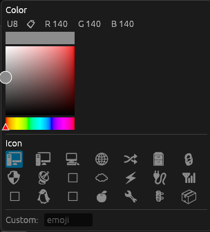

# Session manager

The **Sessions** view (🖥) is where saved connections live. A session is a saved
definition for an SSH, RDP, or VNC connection — it holds host, port, username,
options, and a *reference* to a vault credential, but **never a secret itself**.

## Creating and editing

- **New session**: the **+** button, or right-click the pane → **New session**.
- The editor has a **type picker** (SSH / RDP / VNC) that adjusts the fields and
  the default port, plus protocol-specific options (SSH auth and legacy mode; RDP
  resolution/quality/domain; VNC view-only/quality).

  | SSH | RDP | VNC |
  |---|---|---|
  |  |  |  |

- **Icon & color**: one picker shows a grid of icons that recolor live as you
  choose a color, so you can tag sessions visually. There's also a custom-emoji
  option.

  

## Folders

- Sessions are organised in **nested folders** (`work/prod`-style paths).
- Folders **start collapsed** so large trees stay readable; a folder with nothing
  in it shows **no expand arrow**.
- Create folders from the pane's or a folder's right-click menu, or by typing a
  `/`-path into a session's **Folder** field.
- A folder has its own **Edit** dialog to rename it and set its icon/color.

## Quick connect

The **Quick** box at the top of the Sessions pane connects immediately: type
`user@host` (optionally `user@host:port`) and press Enter.

## Right-click actions

Session and folder menus follow a consistent layout: specific actions first, then
a separator, then generic actions (**Copy to**, **Delete**, **Duplicate**,
**Edit…**, **Move to**) in alphabetical order.

A **session** menu offers Connect, Connect as…, Open web GUI, a **Network tools**
submenu (ping, port scans, subnet scan — see [Tools](tools.md)), and the generic
actions. **Move to / Copy to** target any store and folder, including shared
sources.

## Drag and drop

Drag a session onto a folder (or onto a shared source's header for its root) to
move it. Drag a whole folder to re-parent it and everything inside. Dropping
offers move/copy where it makes sense.

## Broadcast and splits

Opening several sessions into one tab's split panes, then arming **broadcast**,
lets you drive many devices at once — see [Terminal](terminal.md).
