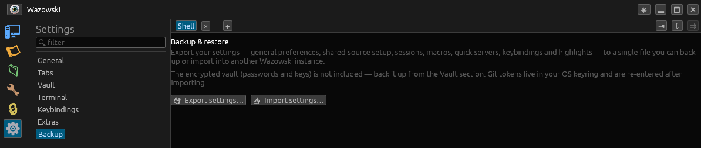

# Settings & backup

Open the **Settings** view (⚙). The left pane lists categories; the search box
filters them by name or by the settings they contain. All config is stored as
plain TOML files in your config dir (`~/.config/wazowski/` on Linux).

## Categories

### General
- **Allow multiple instances** — run a second Wazowski alongside the first.
- **Startup tab** — start with the welcome screen, a local shell, or by connecting
  to a chosen saved session.
- **Open web GUI scheme** — whether the session "Open web GUI" action uses
  `https://` or `http://`.

### Tabs
- **New-tab placement** — far right, next to the current tab, or only duplicates
  next to the current tab.

### Vault
- **Automatic vault backup** — enable, set frequency (days) and destination
  folder. See [Vault](vault.md).

### Terminal
- **Font size** (default for new terminals).
- **Highlights** — regex rules that recolor matching terminal text; edit, add, or
  reset to defaults.

### Keybindings
- View and rebind every shortcut. See [Keyboard shortcuts](keybindings.md).

### Extras
- **Environment checks** for optional tools/permissions: low-port permission
  (with a one-click `setcap` grant on Linux), `iperf3` (with install), printing
  (CUPS), `jq`, `smbclient`, an RDP client, a VNC viewer, and your default
  browser — each with status and, where possible, a fix button.
- **Preferred RDP client** and **Preferred VNC viewer** (for the external-launch
  fallbacks).

### Backup
- Export/import your whole configuration — below.

## Backup & restore

**Settings → Backup** bundles all of your configuration into **one portable
file** you can back up or carry to another machine:

- general settings, **shared-source setup**, local sessions, macros, quick
  servers, keybindings, and highlight rules.

Buttons:

- **💾 Export settings…** — write the bundle wherever you choose (default
  `wazowski-settings.toml`).
- **📥 Import settings…** — pick a backup, confirm (it replaces current config),
  and it's applied immediately. Running quick servers keep running across an
  import; restart Wazowski if anything looks out of date.

### What's excluded (on purpose)

- The **encrypted vault** (passwords/keys) — it has its own backup in the Vault
  section, so secrets don't travel in a plain settings file.
- **Git tokens** — these live in your OS keyring, not in files, so you re-enter
  them after importing on a new machine.

The backup is a self-contained file with each config file embedded; import only
writes back known config filenames, so a stray or crafted file can't write
elsewhere.
