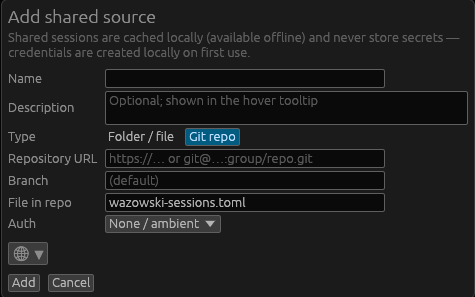

# Shared sessions

A **shared source** lets a team keep a common set of sessions in one place. Each
source appears as its own collapsible section in the Sessions pane, alongside your
local sessions.

Sources never store secrets — shared sessions reference vault entries by name, and
each user creates those credentials locally on first use.

## Kinds of source

- **Folder / file** — a sessions file on a shared or synced location (network
  mount, NAS, Dropbox/Nextcloud folder, …).
- **Git repo** — a repository on GitHub, GitLab, Forgejo, etc. Auth can be:
  - **None / ambient** (public repo or your existing git credentials),
  - **HTTPS token** (stored in your OS keyring, sent as a header — never written
    to the repo config), or
  - **SSH key** (a specific key, or your agent/default key).

Either way, the source is **cached locally**, so the sessions stay available even
when the share or remote is offline (read-only until it's reachable again).

## Adding a source

Sessions pane → right-click → **Add shared source…**, then choose the kind and
fill in the details. A **Description** field (below) and an icon/color round it
out. A brand-new source's file is created for you so it's immediately usable.

### Description

The source's **description** is stored **inside the shared sessions file**, so it
travels with the sessions — everyone who opens the source sees it. It appears at
the top of the source's hover tooltip (above the connection details), and shows
even when you're offline (read from the local cache).

## Syncing and pushing changes

Shared sources are **never auto-synced** — they refresh only when first opened and
when you explicitly **Sync now** (right-click the source header). This keeps
incoming changes and outgoing pushes under your control.

For **git** sources, your edits are committed **locally** and not pushed
immediately. Pushing is a deliberate step:

- **Sync now** pulls incoming changes first. If you then have **outgoing** changes
  to push, it asks to confirm the push. A sync that's purely incoming pushes
  nothing and doesn't prompt.
- **On quit**, if any source has unpushed changes, the quit dialog offers to
  **Push & quit** or **Discard & quit**. A failed push is non-destructive — the
  local commits remain and are offered again next launch.

For **folder** sources there's nothing to push: writes go straight to the shared
file, and **Sync now** just re-reads it.

## Offline behaviour

If a source is unreachable, Wazowski keeps using the local cache (read-only) and
tells you. For a folder source whose file has gone missing, you can **recreate**
it from the cache. Edits are disabled while a source is offline, to avoid
conflicting with it.

## Moving sessions between stores

**Move to / Copy to** in a session or folder's right-click menu can target any
store — your local sessions or any reachable shared source — and any folder within
it. See [Session manager](session-manager.md).
