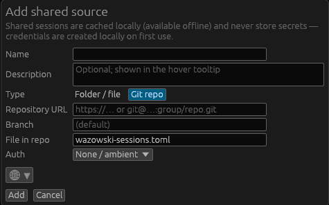

# Shared sessions

A **shared source** lets a team keep a common set of sessions in one place. Each
source appears as its own collapsible section in the Sessions pane, alongside your
local sessions.

Sources never store secrets — shared sessions reference vault entries by name, and
each user creates those credentials locally on first use. **No usernames are
stored either**: a session's username comes from the connect prompt or a vault
entry, never from a file.

A source is stored as an exploded **directory tree** (see [How it's stored](#how-its-stored)):
one repo (or one folder) is one source, laid out so that editing one session
touches one file — which keeps a team's git history clean and conflict-free.

## Kinds of source

- **Folder** — a directory holding the session tree, on a shared or synced
  location (network mount, NAS, Dropbox/Nextcloud folder, …).
- **Git repo** — a repository on GitHub, GitLab, Forgejo, etc.; the whole repo is
  one source. Auth is either:
  - **None / ambient** (public repo or your existing git credentials), or
  - **Vault entry** — authenticate from a [vault](vault.md) credential. Add a
    **password** entry (its password is the HTTPS token; set the username for
    GitLab/Forgejo — GitHub PATs don't need one) or an **SSH keypair** entry,
    then pick it. Credentials live only in the encrypted vault — never in a
    config file or the OS keyring. The vault must be unlocked for the source to
    sync; while it's locked the source stays on its offline cache and re-syncs
    once you unlock. (A passphrase-protected keypair is decrypted in memory for
    git; the key is written only to a private, 0600 temporary file for the SSH
    call and deleted afterward.)

  Sources created in older versions with a keyring token or key-file still sync;
  switch them to a vault entry to change their credentials.

Either way, the source is **cached locally**, so the sessions stay available even
when the share or remote is offline (read-only until it's reachable again).

## Adding a source

Sessions pane → right-click → **Add shared source…**, then choose the kind and
fill in the details, including an optional **description, icon, and color**. A
brand-new source's tree is created for you so it's immediately usable. Adding the
same repo (or folder) twice is refused — one repo is one source.

### Name, appearance & description

The source's **name, description, icon, and color** all live **inside the tree's
root `.folder`**, so they travel with the sessions — everyone who opens the source
sees the same name and styling, and **renaming the source renames it for everyone**.
If the root has no name yet, the source shows its `org/repo` (git) as a fallback.
The description and the remote identity appear in the source's hover tooltip; the
icon and color style its header. All of it shows even when you're offline (read
from the local cache).

> Sources and files created in an older (single-file) version are migrated to the
> tree automatically the first time you open them (for a git repo, as one
> "Migrate…" commit you then push).

## Syncing and pushing changes

Shared sources are **never auto-synced** — they refresh only when first opened and
when you explicitly **Sync now** (right-click the source header). This keeps
incoming changes and outgoing pushes under your control.

For **git** sources, your edits are committed **locally** and not pushed
immediately. Pushing is a deliberate step:

- **Sync now** pulls incoming changes first. If you then have **outgoing** changes
  to push, it asks to confirm the push — with a **preview** of what would go out,
  a **Push** button, and a **Discard & pull fresh** button that throws your local
  changes away and replaces them with the remote copy (useful to undo a bad edit).
  A sync that's purely incoming pushes nothing and doesn't prompt.
- **On quit**, if any source has unpushed changes, the quit dialog offers to
  **Push & quit** or **Discard & quit**. A failed push is non-destructive — the
  local commits remain and are offered again next launch.

Each change you make is recorded as its own descriptive git commit (e.g.
`Session deleted: db | work 📂 prod`), so the repo history is readable. Before you
push, the confirmation dialog has a collapsible **preview** listing exactly which
changes will go out — click to expand it, so nothing is pushed sight-unseen.

For **folder** sources there's nothing to push: writes go straight to the shared
directory, and **Sync now** just re-reads it.

## How it's stored

A source is a directory tree, not one file:

- Each **folder** is a directory with a `.folder` sidecar carrying its name, icon,
  color, and a stable id.
- Each **session** is a `<slug>.wzsession` file inside its folder's directory.
- The **root `.folder`** carries the source's own name/icon/color/description.

Directory and file names are slugs; the human display name and a stable UUID live
*inside* each file, so renaming or moving something never breaks links, and two
items can share a display name. Crucially, **one session is one file**, so two
people editing different sessions produce independent commits that merge cleanly —
no more whole-file conflicts. Folders and sessions are always shown in
alphanumeric order (sessions first, then subfolders); arrange them by naming.

## Offline behaviour

If a source is unreachable, Wazowski keeps using the local cache (read-only) and
tells you. For a folder source whose directory has gone missing, you can
**recreate** it from the cache. Edits are disabled while a source is offline, to
avoid conflicting with it.

## Moving sessions between stores

**Move to / Copy to** in a session or folder's right-click menu can target any
store — your local sessions or any reachable shared source — and any folder within
it. See [Session manager](session-manager.md).
