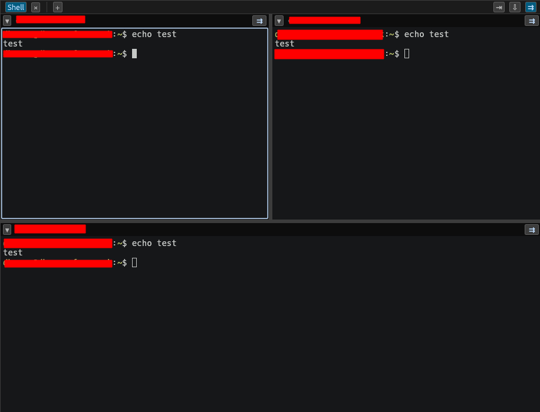

# Terminal, tabs & panes

Wazowski's terminal is a full emulator (built on `alacritty_terminal`) with
colors, scrollback, selection, and copy/paste. Every local shell, SSH session,
and serial console runs in one.

## Tabs

- The **+** button on the tab strip opens a new **local shell** tab
  (`Ctrl+Shift+T`).
- Switch tabs with `Ctrl+PageUp` / `Ctrl+PageDown`, or click them.
- Close a tab with its `×`, or `Ctrl+Shift+W`.
- Where new tabs appear (far right, next to current, or only duplicates next to
  current) is configurable — see [Settings](settings-and-backup.md).

**Tab right-click menu** includes:

- **Duplicate** the tab's session.
- **Save output…** — write the tab's current scrollback to a text file.
- **Print output** — send the scrollback to a printer (needs `lp`/`lpr`/CUPS).

## Split panes

A tab can be split so several terminals share one tab:

- **Split right** — `Ctrl+Shift+E`
- **Split down** — `Ctrl+Shift+O`
- **Close focused pane** — `Ctrl+Shift+X`

Click a pane to focus it; keystrokes go to the focused pane.

## Broadcast typing

**Broadcast** sends your keystrokes to *every* pane in the current tab at
once — handy for running the same command on many devices.

- Toggle it with `Ctrl+Shift+B`, or the broadcast button in the toolbar.
- While armed, an indicator shows broadcast is on, and you can **exclude**
  individual panes.
- Switching tabs automatically disarms broadcast, so you don't accidentally type
  into the wrong set of panes.

## Find

`Ctrl+Shift+F` opens **Find in terminals** to search the visible terminal
output.

## Font size

- Larger / smaller / reset: `Ctrl+=`, `Ctrl+-`, `Ctrl+0`.
- Also `Ctrl+scroll` in a terminal.
- The default size is set in **Settings → Terminal**.

## Highlights

**Settings → Terminal** also holds **highlight rules**: regex patterns that
recolor matching text in the terminal (for example, make `ERROR` red). You can
edit, add, and reset rules to the built-in defaults.

## Copy and paste

- **Select** text to copy it (copy-on-select), or use your platform's copy key.
- **Right-click** pastes.
- In RDP/VNC sessions, use the toolbar's **paste** button — see
  [Connections](connections.md).
