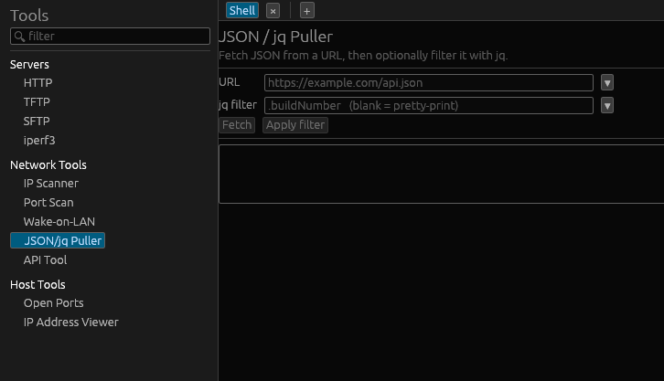
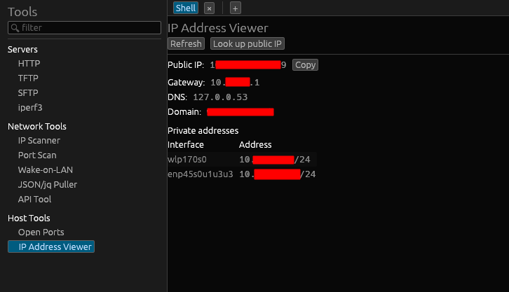

# Network & host tools

Under **Tools** (🔧), alongside [Quick servers](quick-servers.md), Wazowski groups
its utilities into **Network Tools** and **Host Tools**. There are also
per-session network tools in the session right-click menu.

- **Network Tools**: IP Scanner, Port Scan, Wake-on-LAN, JSON/jq Puller, API Tool
- **Host Tools**: Open Ports, IP Address Viewer

## IP Scanner

Ping-sweep a subnet and probe common services:

- Enter a **subnet** in CIDR form (e.g. `10.0.0.0/24`) and run a **Ping sweep**;
  a spinner shows progress and you can **Stop** it.
- Each host is listed with a reachable/▪ indicator and any detected services; a
  **Port scan** button next to a host jumps to the Port Scan tool for it.

## Port Scan

Scan a host's TCP ports — enter a target and scan the common ports or a range.
(The per-session right-click menu runs the same scans against a saved session's
host; see [below](#per-session-network-tools).)

## Wake-on-LAN

Wake a machine by sending a **magic packet** to its MAC address:

- Enter the **MAC** (e.g. `AA:BB:CC:DD:EE:FF`) and **Send magic packet**. The
  packet is broadcast on the local network; the tool reports success or an error.

## JSON / jq puller

Fetch a URL and work with its JSON response.

- Enter a **URL** and fetch it; the response is pretty-printed.
- Apply a **jq filter** to transform/extract (uses the system `jq`; install it to
  enable filtering — see **Settings → Extras**).
- **Saved URLs and filters**: start typing in either box to see matching saved
  entries, or use the drop-down button to browse them. Right-click a saved entry
  to delete it (with confirmation).

**Example** — from a downloads API, show only Linux client installers:

```
.installers[] | select(.platform=="linux_x64" and .appType=="client")
```



## API Tool

A basic API client for pushing and pulling data:

- Choose a **method** (GET/POST/…), enter a **URL**, and send.
- Supply headers/body as needed and read the response (status, headers, body).
- URLs can be **saved** and autocompleted like the JSON puller.

## Open Ports

Lists **this machine's** listening sockets (local open ports). Click **Refresh**
to populate or update the list — handy for checking what's exposed, including any
[quick servers](quick-servers.md) you've started.

## IP Address Viewer

A host networking overview — handy when you just need your addresses fast:

- **Public IP**
- **Private/interface addresses** and their **subnets**
- **Default gateway**
- **DNS servers** and **search domain**



## Per-session network tools

Right-click a session → **Network tools** runs a quick check against that host:

- **Ping**
- **Port scan (common)**
- **Port scan (1–1024)**
- **Scan subnet (/24)**

Results open in a tab, so you can keep them around or save/print the output like
any terminal (see [Terminal](terminal.md)).
