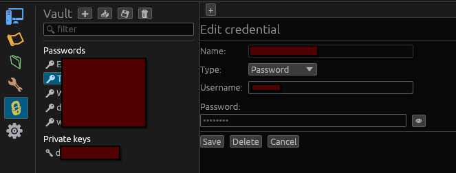

# Vault (credentials)

The vault is Wazowski's encrypted store for secrets — passwords and private keys.
Sessions never contain secrets; they reference a **named** vault entry, so one
credential can be shared by many sessions.

## Encryption

- The vault is encrypted with **XChaCha20-Poly1305**, with the key derived from
  your master password via **Argon2id**.
- It can be **auto-unlocked** via your OS keyring, so you don't retype the master
  password every launch. (This is optional; you can also unlock manually each
  time.)

## Unlocking and creating

Open the **Vault** view (🔒):

- If no vault exists, you're prompted to **create** one (set a master password).
- If it exists but is locked, **Unlock vault** prompts for the master password,
  with an option to remember it via the keyring.

While the vault is locked or absent, password/key auth is disabled and sessions
that need a secret will say so.

## Managing credentials

In the vault view you can:

- **Add** a credential (`➕`): a named password or a private key (PEM), optionally
  with a username stored alongside it.
- **Edit / delete** entries.
- **Reveal** a secret's value — this re-asks for the master password first.
- **Generate** an **Ed25519** key pair to use for SSH auth.

## How sessions use the vault

When you set a session's auth to **Password** or **Key**, you either pick an
existing entry or create a new one. A session with a blank password and no entry
simply prompts you at connect time (and can offer to save what you enter).

## Backups

- **Back up the vault…** (`💾`) writes an encrypted copy wherever you choose.
- **Import a vault file…** (`📥`) restores one.
- **Automatic backups** can be enabled in **Settings → Vault** (frequency and
  destination folder).

> The vault is **not** included in the general settings backup
> ([Settings & backup](settings-and-backup.md)) — secrets have their own backup
> so they don't travel in a plain config file.
