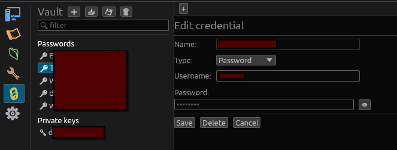

# Vault (credentials)

The vault is Wazowski's encrypted store for secrets — passwords, SSH keypairs,
and tokens. Sessions never contain secrets; they reference a vault entry by its
stable **id**, so one credential can be shared by many sessions.

## Encryption

- The vault is encrypted with **XChaCha20-Poly1305**, with the key derived from
  your master password via **Argon2id**.
- It can be **auto-unlocked** via your OS keyring, so you don't retype the master
  password every launch. (This is optional; you can also unlock manually each
  time.)

## Unlocking and creating

Open the **Vault** view (🔒):

- If no vault exists, you're prompted to **create** one (set a master password).
- If it exists but is locked, **Unlock vault** prompts for the master password,
  with an option to remember it via the keyring.

While the vault is locked or absent, password/key auth is disabled and sessions
that need a secret will say so.

## Managing credentials

In the vault view you can:

- **Add** a credential (`➕`): a named **password**, **SSH keypair**, or
  **token**, optionally with a username stored alongside it. A keypair holds a
  private key (PEM) and, optionally, its public key — paste just the private key,
  or both. A **token** holds a single secret string (a GitHub HTTPS token, an API
  key, etc.). Entries are grouped by kind (Passwords / SSH Keypairs / Tokens).
- **Edit / rename / delete** entries. Each entry has a stable internal **id**
  (derived from its first name, e.g. "VNC password" → `vnc-password`), and
  sessions reference that id — so you can **rename an entry freely** and every
  session that uses it stays linked. Because the id is derived from the name,
  teammates who name an entry the same way get the same id, so **shared sessions
  resolve for everyone**. The id is shown in grey **next to the name box**: while
  you're creating an entry it previews the slug the current name would get (live);
  once the entry exists it's fixed and never changes, even on rename.
- **Duplicate** an entry — this opens the editor as a **new** entry with the
  original's fields prefilled, so its id follows the name you give the copy (and
  locks in once saved, like any new entry). The copied secret is carried over
  **without being shown**: it appears as dots, revealing it still requires the
  master password, and it's saved into the duplicate even if you never reveal it.
- **Reveal** a secret's value — this re-asks for the master password first.
- **Generate an SSH keypair** to use for SSH auth. Choose the algorithm
  (**Ed25519**, **RSA 4096**, or **ECDSA P-256**) and optionally set a passphrase
  to encrypt the private key. Both keys are stored, and the public key is shown so
  you can copy it to a server's `authorized_keys`.

## How sessions use the vault

Every session (and shared source) chooses between two auth modes:

- **Prompt Everytime** — nothing is stored; you're asked for the password each
  time you connect. The session's username is offered as an editable default.
- **From Vault** — the session references a vault entry. The "From Vault" picker
  shows the entries grouped by kind (collapsed by default); expand a group and
  pick one. You can also create a new entry inline (a name and value are
  required). Shared sources offer **None** instead of Prompt (public repos need
  no auth); a private repo uses a **Token** or **SSH keypair** entry.

Because sessions reference entries by **id**, you can rename an entry freely and
every session stays linked.

## Paste a password into a session

Off by default, this can be turned on in **Settings → Vault → Paste password**.
Once enabled, a connected terminal tab's right-click menu gains **Paste
password…**. It asks for the **master password**, then lets you pick a password
entry and types its value into the session's focused pane (with no trailing
Enter, so you can review before submitting). The master password is required
every time — unless you tick **Remember for this session**, which skips the
prompt for subsequent pastes until Wazowski is closed.

## Tokens in the API tools

The **API Tool** and **JSON / jq Puller** can authenticate from a vault token.
Expand **Authorization (optional)** and pick a **Token** (or Password) entry; it
is sent as `Authorization: Bearer <token>` (an `Authorization` header you type in
by hand takes precedence).

## Backups

- **Back up the vault…** (`💾`) writes an encrypted copy wherever you choose.
- **Import a vault file…** (`📥`) restores one.
- **Automatic backups** can be enabled in **Settings → Vault** (frequency and
  destination folder).

> The vault is **not** included in the general settings backup
> ([Settings & backup](settings-and-backup.md)) — secrets have their own backup
> so they don't travel in a plain config file.
